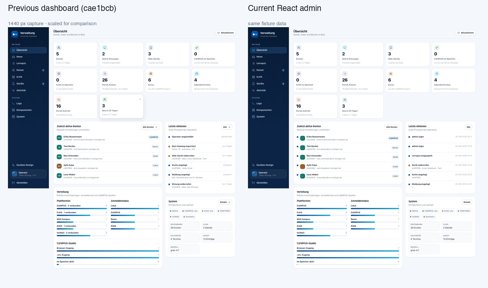
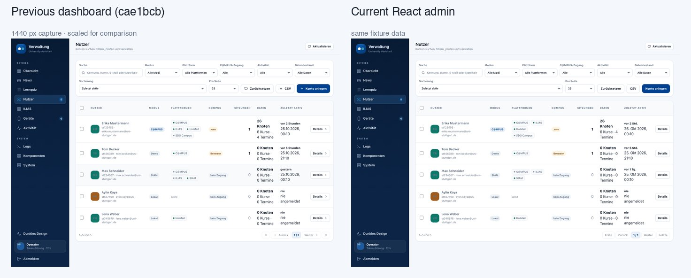
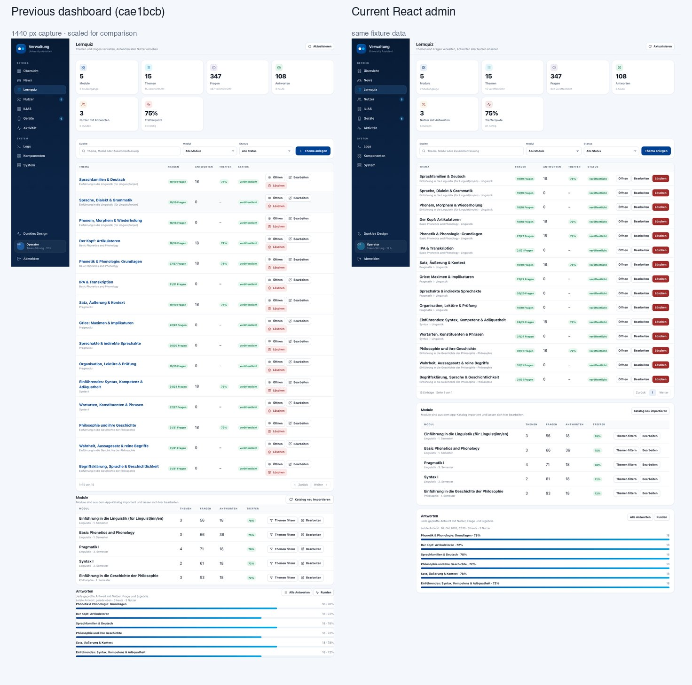
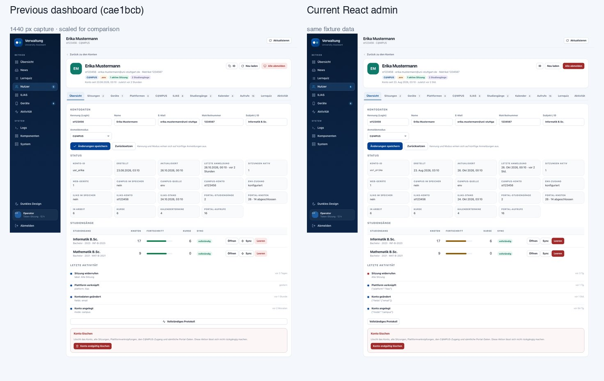

# Admin UI parity screenshots

These screenshots compare the pre-migration dashboard at commit `cae1bcb`
with the current React/Vite admin. Both sides use the same seeded fixture database,
so layout, tables, dialogs and empty states are comparable.

- `side-by-side/` – direct before/after images, labelled and grouped by route.
- `previous/` – full-resolution screenshots of the old dashboard.
- `current/` – full-resolution screenshots of the React admin.

The folder structure mirrors the admin routes, for example
`users/detail/05-campus.png`.

See [INTERACTIONS.md](INTERACTIONS.md) for the click-through audit: which
rows, tabs, dialogs, links and confirmations were exercised, and which KPI
tiles are intentionally static for parity with the old dashboard.

## Key comparisons

### Übersicht

### Nutzer

### Lernquiz

### Nutzerdetail

## All screens

### Betrieb

| Screen | Previous | Current | Side by side |
| --- | --- | --- | --- |
| Login | [vorher](previous/login.png) | [nachher](current/login.png) | [direkt](side-by-side/login.jpg) |
| Übersicht | [vorher](previous/overview.png) | [nachher](current/overview.png) | [direkt](side-by-side/overview.jpg) |
| News | [vorher](previous/news.png) | [nachher](current/news.png) | [direkt](side-by-side/news.jpg) |
| ILIAS | [vorher](previous/ilias.png) | [nachher](current/ilias.png) | [direkt](side-by-side/ilias.jpg) |
| Geräte – Liste | [vorher](previous/devices/01-list.png) | [nachher](current/devices/01-list.png) | [direkt](side-by-side/devices/01-list.jpg) |
| Geräte – Detail | [vorher](previous/devices/02-detail.png) | [nachher](current/devices/02-detail.png) | [direkt](side-by-side/devices/02-detail.jpg) |
| Aktivität | [vorher](previous/audit.png) | [nachher](current/audit.png) | [direkt](side-by-side/audit.jpg) |

### Lernquiz

| Screen | Previous | Current | Side by side |
| --- | --- | --- | --- |
| Katalog | [vorher](previous/quiz/01-catalog.png) | [nachher](current/quiz/01-catalog.png) | [direkt](side-by-side/quiz/01-catalog.jpg) |
| Thema | [vorher](previous/quiz/02-topic.png) | [nachher](current/quiz/02-topic.png) | [direkt](side-by-side/quiz/02-topic.jpg) |
| Antworten | [vorher](previous/quiz/03-attempts.png) | [nachher](current/quiz/03-attempts.png) | [direkt](side-by-side/quiz/03-attempts.jpg) |
| Runden | [vorher](previous/quiz/04-sessions.png) | [nachher](current/quiz/04-sessions.png) | [direkt](side-by-side/quiz/04-sessions.jpg) |

### Nutzer

| Screen | Previous | Current | Side by side |
| --- | --- | --- | --- |
| Liste | [vorher](previous/users/01-list.png) | [nachher](current/users/01-list.png) | [direkt](side-by-side/users/01-list.jpg) |
| Anlegen-Dialog | [vorher](previous/users/02-create-dialog.png) | [nachher](current/users/02-create-dialog.png) | [direkt](side-by-side/users/02-create-dialog.jpg) |
| Detail – Übersicht | [vorher](previous/users/detail/01-overview.png) | [nachher](current/users/detail/01-overview.png) | [direkt](side-by-side/users/detail/01-overview.jpg) |
| Detail – Sitzungen | [vorher](previous/users/detail/02-sessions.png) | [nachher](current/users/detail/02-sessions.png) | [direkt](side-by-side/users/detail/02-sessions.jpg) |
| Detail – Geräte | [vorher](previous/users/detail/03-devices.png) | [nachher](current/users/detail/03-devices.png) | [direkt](side-by-side/users/detail/03-devices.jpg) |
| Detail – Plattformen | [vorher](previous/users/detail/04-platforms.png) | [nachher](current/users/detail/04-platforms.png) | [direkt](side-by-side/users/detail/04-platforms.jpg) |
| Detail – C@MPUS | [vorher](previous/users/detail/05-campus.png) | [nachher](current/users/detail/05-campus.png) | [direkt](side-by-side/users/detail/05-campus.jpg) |
| Detail – ILIAS | [vorher](previous/users/detail/06-ilias.png) | [nachher](current/users/detail/06-ilias.png) | [direkt](side-by-side/users/detail/06-ilias.jpg) |
| Detail – Studiengänge | [vorher](previous/users/detail/07-data.png) | [nachher](current/users/detail/07-data.png) | [direkt](side-by-side/users/detail/07-data.jpg) |
| Detail – Kalender | [vorher](previous/users/detail/08-calendar.png) | [nachher](current/users/detail/08-calendar.png) | [direkt](side-by-side/users/detail/08-calendar.jpg) |
| Detail – Aufrufe | [vorher](previous/users/detail/09-calls.png) | [nachher](current/users/detail/09-calls.png) | [direkt](side-by-side/users/detail/09-calls.jpg) |
| Detail – Lernquiz | [vorher](previous/users/detail/10-quiz.png) | [nachher](current/users/detail/10-quiz.png) | [direkt](side-by-side/users/detail/10-quiz.jpg) |
| Detail – Aktivität | [vorher](previous/users/detail/11-audit.png) | [nachher](current/users/detail/11-audit.png) | [direkt](side-by-side/users/detail/11-audit.jpg) |

### System

| Screen | Previous | Current | Side by side |
| --- | --- | --- | --- |
| Logs | [vorher](previous/logs.png) | [nachher](current/logs.png) | [direkt](side-by-side/logs.jpg) |
| Komponenten | [vorher](previous/components.png) | [nachher](current/components.png) | [direkt](side-by-side/components.jpg) |
| System | [vorher](previous/system.png) | [nachher](current/system.png) | [direkt](side-by-side/system.jpg) |

## Notes

- Previous screenshots are served from `git archive cae1bcb server/dashboard`
  through a same-origin proxy, so the old frontend talks to the current API.
- Current screenshots are the React admin at `apps/admin`.
- Interactive differences are kept visible: the old quiz opens a topic as a
  dedicated page and devices have a detail page, while the React admin uses
  dialogs for both.
- Regenerate with `node tools/admin-screenshots/capture.mjs`. It boots a
  temporary server and database with deterministic fixtures and does not touch
  your local data.
